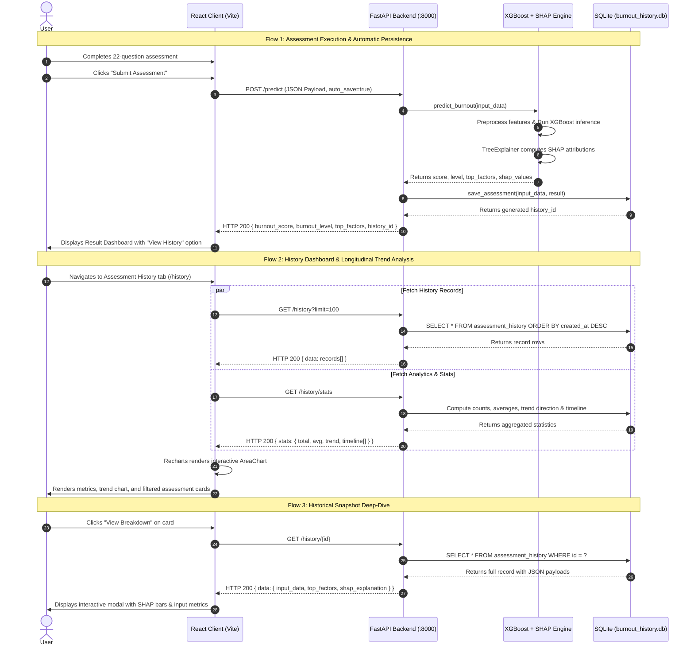
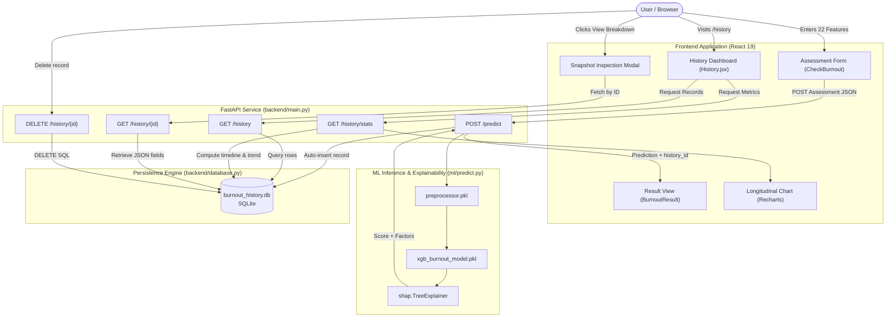

# Burnout Detection AI — User History Architecture Flow

This document details the architectural design, data lifecycle, system diagrams, and integration points for the **User Assessment History** feature in the Burnout Detection AI application.

---

## 1. Architectural Overview

Prior to this feature, burnout assessments were ephemeral: once a user completed the 22-parameter assessment, the prediction and SHAP explainability insights were displayed once and lost upon browser reload or navigation.

The **User History Architecture** provides longitudinal tracking of burnout risk over time, allowing users to:
1. **Persist Assessments Automatically**: Every ML inference execution automatically records inputs, calculated risk scores, risk levels, and SHAP feature attributions.
2. **Visualize Trajectory Trends**: An interactive area chart displays historical burnout risk percentage changes across assessments.
3. **Analyze Health Direction**: An analytical aggregation engine calculates whether a user's burnout risk is *Improving*, *Stable*, or *Worsening*.
4. **Inspect Historical Snapshots**: Users can inspect the exact lifestyle, workload parameters, and explainability factors that drove past assessments.
5. **Manage Data Privacy**: Users have full control to inspect, delete individual records, or clear their entire assessment history.

```
+-----------------------------------------------------------------------------------+
|                                PRESENTATION TIER                                  |
|                                                                                   |
|  [React 19 + Vite]              [Recharts AreaChart]         [History UI Modals]  |
|  - CheckBurnout Form            - Burnout Trajectory         - SHAP Explanations  |
|  - BurnoutResult Summary        - Risk Level Bands           - Lifestyle Snapshot |
|  - History Dashboard            - Date-based Tooltips        - Deletion Controls  |
+------------------------------------------+----------------------------------------+
                                           | HTTP / REST (Fetch API)
                                           v
+-----------------------------------------------------------------------------------+
|                             APPLICATION SERVICE TIER                              |
|                                                                                   |
|  [FastAPI / Uvicorn Service - Port 8000]                                          |
|  - POST /predict (Inference + Auto-Save)     - GET /history (Filter & Pagination) |
|  - GET /history/stats (Trend Aggregates)     - GET /history/{id} (Full Snapshot)  |
|  - DELETE /history/{id} (Single Deletion)    - DELETE /history (Clear All)        |
+---------------------+------------------------------------+------------------------+
                      |                                    |
                      v                                    v
+------------------------------------+   +------------------------------------------+
|      INTELLIGENCE LAYER (ML)       |   |         PERSISTENCE LAYER (DB)           |
|                                    |   |                                          |
|  - XGBoost Classifier / Regressor  |   |  - SQLite (burnout_history.db)           |
|  - Preprocessor Pipeline (OneHot)  |   |  - assessment_history Table              |
|  - TreeSHAP Local Explainer        |   |  - B-Tree Indexes (created_at, level)    |
|  - Risk Categorization Engine      |   |  - JSON Serialization for SHAP & Inputs  |
+------------------------------------+   +------------------------------------------+
```

---

## 2. End-to-End System Sequence Flow

The following sequence diagram outlines the entire flow from assessment submission to ML scoring, storage, and subsequent history review.



---

## 3. Data Flow Diagram (DFD Level 1)



---

## 4. Database Schema & Data Dictionary

The persistence layer uses a local SQLite database file located at `backend/burnout_history.db`.

### Table: `assessment_history`

| Column | Type | Constraints | Description |
| :--- | :--- | :--- | :--- |
| `id` | `INTEGER` | `PRIMARY KEY AUTOINCREMENT` | Unique identifier for each assessment. |
| `created_at` | `TEXT` | `NOT NULL` | ISO 8601 formatted timestamp (e.g. `2026-10-28T21:46:53`). |
| `user_name` | `TEXT` | `DEFAULT 'Anonymous'` | Name or pseudonym of the user. |
| `burnout_score` | `REAL` | `NOT NULL` | Continuous ML model burnout score (0.00 – 10.00). |
| `burnout_level` | `TEXT` | `NOT NULL` | Categorical risk band: `Low`, `Moderate`, or `High`. |
| `job_role` | `TEXT` | `NULLABLE` | User's job position (e.g. Software Engineer, Designer). |
| `work_mode` | `TEXT` | `NULLABLE` | `Remote`, `Hybrid`, or `Onsite`. |
| `work_hours_per_week`| `REAL` | `NULLABLE` | Weekly reported working hours. |
| `stress_level` | `REAL` | `NULLABLE` | Self-reported stress level (1.0 – 10.0). |
| `sleep_hours` | `REAL` | `NULLABLE` | Average daily sleep hours. |
| `top_factors` | `TEXT` | `NULLABLE` | JSON array containing the top 5 SHAP contributing factors. |
| `shap_explanation` | `TEXT` | `NULLABLE` | JSON array containing complete feature attribution values. |
| `input_data` | `TEXT` | `NULLABLE` | Full JSON serialized dictionary of all 22 assessment parameters. |

### Database Indexes

To ensure sub-millisecond retrieval speeds as the user's history grows:
- `idx_history_created_at`: Index on `(created_at DESC)` for chronological timeline sorting.
- `idx_history_burnout_level`: Index on `(burnout_level)` for rapid filtering (High / Moderate / Low).

---

## 5. API Endpoints Specification

### 1. `POST /predict`
Executes ML inference, calculates SHAP attributions, and automatically records the assessment.
- **Query Parameter**: `auto_save` (bool, default `True`)
- **Response**:
```json
{
  "burnout_score": 4.77,
  "burnout_level": "Moderate",
  "top_factors": [
    {
      "feature": "numerical__stress_level",
      "impact": 0.5145,
      "direction": "increases"
    }
  ],
  "shap_explanation": [...],
  "history_id": 1
}
```

### 2. `GET /history`
Retrieves paginated historical evaluations.
- **Query Parameters**:
  - `limit` (int, default `50`): Maximum records to retrieve.
  - `offset` (int, default `0`): Pagination offset.
  - `level` (str, optional): Filter by `Low`, `Moderate`, `High`, or `All`.
- **Response**:
```json
{
  "status": "success",
  "count": 3,
  "data": [
    {
      "id": 4,
      "created_at": "2026-10-28T21:46:53.187306",
      "user_name": "Anonymous",
      "burnout_score": 2.85,
      "burnout_level": "Low",
      "job_role": "Frontend Developer",
      "work_mode": "Hybrid",
      "work_hours_per_week": 40.0,
      "stress_level": 3.5,
      "sleep_hours": 7.5,
      "top_factors": [...]
    }
  ]
}
```

### 3. `GET /history/stats`
Returns aggregated analytics, risk distribution, longitudinal trend evaluation, and chart data points.
- **Response**:
```json
{
  "status": "success",
  "stats": {
    "total_assessments": 3,
    "average_score": 5.14,
    "average_percentage": 51.4,
    "min_score": 2.85,
    "max_score": 7.42,
    "latest_score": 2.85,
    "latest_level": "Low",
    "level_distribution": {
      "Low": 1,
      "Moderate": 1,
      "High": 1
    },
    "trend": "improving",
    "trend_description": "Burnout risk decreased by 3.44 pts compared to recent assessments.",
    "timeline": [
      {
        "id": 2,
        "created_at": "2026-10-23T21:46:53.187306",
        "burnout_score": 7.42,
        "burnout_percentage": 74.2,
        "burnout_level": "High",
        "stress_level": 9.0,
        "work_hours": 58.0
      }
    ]
  }
}
```

### 4. `GET /history/{id}`
Returns complete assessment details, including the full 22-input feature snapshot and SHAP values.

### 5. `DELETE /history/{id}`
Deletes a specific assessment record.

### 6. `DELETE /history`
Purges all assessment records, resetting history metrics.

---

## 6. Frontend State & Component Architecture

1. **Global Navigation Header (`Navbar.jsx`)**:
   - Integrated into root layout in `App.jsx`.
   - Links: Home, Check Burnout, Assessment History, How It Works, About.
   - Active route styling with `NavLink`.

2. **History Dashboard (`pages/History.jsx` & `History.css`)**:
   - **Metric Cards**: Total count, latest score & risk badge, average score %, and dynamic health trend indicator (`improving`, `stable`, `worsening`).
   - **Interactive Area Chart**: Built with `recharts`, plotted with an indigo gradient fill, reference threshold lines for Low (<35%) and High (>65%), and custom interactive tooltips.
   - **Filter Controls**: One-click pills for filtering between `All`, `High`, `Moderate`, and `Low` risk records with live counts.
   - **Assessment Cards**: Display time stamp, formatted score progress bar, job role, work hours, sleep hours, and primary driver with directional indicator (↑ Risk or ↓ Protection).
   - **Modal Inspection Drawer**: Inspects the complete historical snapshot and allows immediate transition into personalized recommendations based on that specific historical record.

---

## 7. Security, Privacy & Extensibility

- **Local-First Privacy**: Sensitive psychological, stress, and lifestyle inputs remain stored strictly on the user's local SQLite database instance without external data transmission.
- **ACID Transactions**: SQLite transactions guarantee database integrity during assessment insertions and deletions.
- **Extensibility**: The database structure can seamlessly expand to support multi-user authentication (e.g. `user_id` foreign key via JWT) without redesigning the core schema.
